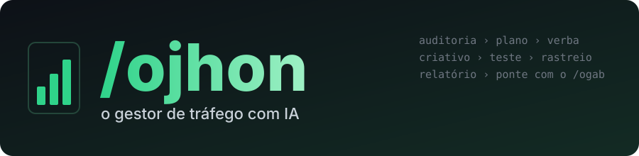

<div align="center">

[](#readme)

[](https://github.com/gabrielxreis/ojhon/commits/main "Histórico")
[](https://claude.com/claude-code "Claude Code")
[](#o-que-o-jhon-faz "O que o Jhon faz")
[](#o-que-o-jhon-faz "O que o Jhon faz")
[](#o-que-o-jhon-faz "Plataformas")
[](#ponte-com-o-gab "Ponte com o Gab")
[](#instalacao "Instalação")
[](LICENSE "Licença")

</div>

**/ojhon** (o Jhon) é uma skill do Claude Code que faz o trabalho de **gestor de tráfego**: audita conta de anúncio em 12 plataformas, monta plano de mídia e verba, calcula CPA, ROAS e MER, cria e audita criativo e copy, olha a biblioteca de anúncios dos concorrentes, acha verba jogada fora, confere rastreamento (Pixel, CAPI, GA4, UTM) e landing page, desenha teste A/B e escreve o relatório para o cliente. Quando o anúncio é em **vídeo**, o Jhon faz o brief, o **Gab ([/ogab](https://github.com/gabrielxreis/ogab))** edita e o Jhon audita o vídeo antes de subir.

> **Nada muda na sua conta de anúncio sem o seu "pode".** Publicar, pausar, apagar, trocar verba, lance ou público: o Jhon monta a proposta e para. Cada aprovação vale para uma ação só.

> **Cada pessoa usa as PRÓPRIAS contas.** A skill não traz conta, chave nem login. Os dados entram por export (CSV, print, planilha) ou pelos conectores que você mesmo liga no seu Claude.

* [NOVIDADES](#novidades)
* [INSTALAÇÃO](#instalacao)
    * [Um comando](#um-comando)
    * [Passo a passo manual](#passo-a-passo-manual)
    * [Atualizar](#atualizar)
    * [Requisitos](#requisitos)
* [USO E COMANDOS](#uso-e-comandos)
    * [Comandos](#comandos)
    * [O que o Jhon faz](#o-que-o-jhon-faz)
    * [O fluxo](#o-fluxo)
* [PONTE COM O GAB](#ponte-com-o-gab)
* [CLIENTES](#clientes)
* [SEGURANÇA](#seguranca)
* [MOTORES](#motores)
* [ESTRUTURA DO REPOSITÓRIO](#estrutura-do-repositorio)
* [LICENÇA](#licenca)


# NOVIDADES

O Jhon se atualiza sozinho toda vez que você usa e **mostra o que mudou** logo no começo da conversa. Histórico completo em [`CHANGELOG.md`](CHANGELOG.md). Últimas:

- **Nasce o Jhon:** auditoria de 12 plataformas, plano de mídia, criativo, concorrentes, rastreamento, landing page, testes, relatório, SEO e visibilidade em IA.
- **Painel no navegador:** todo resultado abre um painel local com resumo, evolução, mapa, investimento por tipo, parecer e campanhas (`painel/`).
- **Meta Ads direto da conta:** conecte o MCP oficial `https://mcp.facebook.com/ads` e o Jhon lê a conta sem export.
- **Dois motores, um gestor:** o [claude-ads](https://github.com/AgriciDaniel/claude-ads) (33 sub-skills e 25 agentes de auditoria) e 49 playbooks do [marketing-skills](https://github.com/irinabuht12-oss/marketing-skills); o Jhon escolhe qual usar em cada pedido.
- **Ponte com o Gab:** brief do anúncio, edição no /ogab e auditoria do criativo antes de subir.

# INSTALAÇÃO

[](#um-comando)
[](install.sh)
[](https://github.com/AgriciDaniel/claude-ads)
[](https://github.com/irinabuht12-oss/marketing-skills)

## Primeiro uso (leia isto)

Depois de instalar, abra o Claude Code e digite **`/ojhon ajuda`**. Depois:
- **Cadastre o cliente:** `/ojhon cliente <nome>`. O Jhon pergunta plataformas, objetivo, meta (CPA, ROAS, CPL), verba e ticket, e guarda em `clientes/<nome>/trafego.md`. A marca (tom, público, o que não dizer) vem do mesmo perfil do Gab.
- **Mande os dados:** export da conta (CSV do Gerenciador de Anúncios ou do Google Ads), print ou planilha.
- **Peça:** `/ojhon auditoria`, `/ojhon por que o CPA subiu?`, `/ojhon plano de mídia de R$ 5 mil`, `/ojhon 4 ganchos para o anúncio X`.
- **O que você recebe no fim:** o que foi feito, as 1 a 3 ações de maior impacto (com o valor em jogo) e o que depende de você.

## Um comando

Cole no **Terminal** do Mac:

```bash
curl -fsSL https://raw.githubusercontent.com/gabrielxreis/ojhon/main/install.sh | bash
```

O [install.sh](install.sh) pode ser rodado de novo para atualizar. Ele:
- baixa a skill em `~/.claude/skills/ojhon` e cria o seu `config.json`;
- instala o motor **claude-ads** a partir da cópia em `vendor/claude-ads` (skill `/ads`, sub-skills `ads-*` e os agentes `audit-*` em `~/.claude/agents`);
- usa um **Python de 3.10 a 3.13** para as dependências do claude-ads (fixadas por hash, num ambiente isolado). Sem esse Python, instala só as skills e avisa;
- confere os 49 playbooks, o `/ads` e os agentes.

## Passo a passo manual

1. **Clonar na pasta de skills do Claude:**
   ```bash
   git clone https://github.com/gabrielxreis/ojhon ~/.claude/skills/ojhon
   ```
2. **Criar a sua configuração** (fica só na sua máquina):
   ```bash
   cp ~/.claude/skills/ojhon/config.example.json ~/.claude/skills/ojhon/config.json
   ```
3. **Instalar o motor claude-ads:**
   ```bash
   bash ~/.claude/skills/ojhon/install.sh --so-ads
   ```
4. **(Opcional) Python 3.12** para as partes com script do claude-ads (print de site, análise de landing, PDF, imagem):
   ```bash
   brew install python@3.12
   ```
5. **(Opcional) Conectores:** se você tiver conector das plataformas no Claude, o Jhon lê os dados por eles; sem conector, tudo funciona com export.

## Atualizar

A skill faz `git pull` sozinha toda vez que é usada (sem tocar no seu `config.json` nem em `clientes/`) e mostra as novidades. Para forçar:

```
/ojhon update
```

## Requisitos

| | Mínimo | Observação |
|---|---|---|
| Sistema | macOS | O claude-ads também roda no Windows (`vendor/claude-ads/install.ps1`) |
| Claude Code | qualquer recente | |
| Python | 3.10 a 3.13 (opcional) | Só para print de site, análise de landing, PDF e imagem do claude-ads. O 3.14 ainda não tem as dependências conferidas |
| Dados | export da conta ou conector | CSV, print ou planilha; o Jhon nunca digita senha |
| /ogab | opcional | Para os anúncios em vídeo (ponte com o Gab) |


# USO E COMANDOS

## Comandos

No Claude Code, chame com `/ojhon` seguido do pedido, ou só peça em linguagem normal:

| Comando | O que faz |
|---|---|
| `/ojhon <pedido>` | Qualquer trabalho de tráfego; o Jhon escolhe o motor |
| `/ojhon cliente <nome>` | Cria ou atualiza o perfil de tráfego do cliente |
| `/ojhon auditoria [cliente] [plataforma]` | Auditoria completa ou de uma plataforma |
| `/ojhon plano [cliente]` | Plano de mídia: objetivo, verba, estrutura, criativo, medição, testes |
| `/ojhon criativo [cliente]` | Ganchos, copy e brief; anúncio em vídeo vai para o Gab |
| `/ojhon concorrente [cliente]` | Biblioteca de anúncios, mensagens, formatos e brechas dos concorrentes |
| `/ojhon relatorio [cliente]` | Resumo da semana e a narrativa do relatório para o cliente |
| `/ojhon ajuda` | O que está instalado e os clientes cadastrados |
| `/ojhon doctor` | Confere o claude-ads, os agentes, as dependências e os playbooks |
| `/ojhon update` | Atualiza a skill |

## O que o Jhon faz

| Área | Exemplos de pedido |
|---|---|
| **Auditoria** | Google, Meta, YouTube, TikTok, LinkedIn, Microsoft, Amazon, Apple, Reddit, Pinterest, Snapchat e X; nota de saúde da conta e riscos |
| **Diagnóstico** | "o CPA subiu", anomalias, verba jogada fora, termos de busca, canibalização de palavra-chave, fadiga de criativo |
| **Plano e verba** | plano de mídia, cenários de verba, divisão entre canais, previsão de ROAS, ritmo de gasto, contas de CPA, MER, LTV:CAC |
| **Criativo** | ganchos e variações de copy para teste, brief de campanha, auditoria de criativo, reaproveitar um conteúdo em vários formatos |
| **Concorrentes** | biblioteca de anúncios do Meta e transparência do Google, posicionamento, landing pages deles |
| **Público** | sobreposição de públicos, frequência, janela de retargeting, perfil de cliente ideal |
| **Rastreamento** | Pixel, CAPI, GA4, atribuição, rastreamento server-side, UTM |
| **Landing page** | coerência entre anúncio e página, conversão, celular, formulário |
| **Testes** | desenho do teste A/B, tamanho de amostra, quando declarar vencedor |
| **Relatório** | resumo da semana e o texto executivo do relatório |
| **SEO e IA** | SEO completo, SEO programático, visibilidade da marca nas respostas do ChatGPT, Claude, Gemini e Perplexity |

## O fluxo

1. **Cliente:** lê a marca (perfil do Gab) e o `trafego.md` (meta, verba, histórico).
2. **Dados:** você manda o export, ou o Jhon lê pelo conector.
3. **Motor:** o Jhon escolhe o claude-ads (diagnóstico amplo, com agentes por plataforma) ou o playbook da tarefa (entrega pontual).
4. **Proposta:** achados com número e fonte, ações por impacto, o que mudar na conta (em rascunho).
5. **Seu "pode":** só então qualquer mudança na conta, uma por vez.
6. **Histórico:** a decisão entra no `trafego.md` do cliente.


# PONTE COM O GAB

Anúncio em vídeo é trabalho dos dois:

| Etapa | Quem | O quê |
|---|---|---|
| 1. Brief | **Jhon** | objetivo, público, oferta, ganchos dos concorrentes, 3 a 4 ganchos para teste, formato e duração por plataforma, CTA e o que a política não deixa dizer. Sai um `brief_anuncio.md` na pasta do vídeo |
| 2. Roteiro e edição | **Gab** (`/ogab`) | roteiro a partir do brief (com a sua aprovação), voz, música, motions, legenda e export; uma versão por gancho se for teste |
| 3. Auditoria do criativo | **Jhon** | gancho nos 3 primeiros segundos, encaixe na plataforma, zona segura, legenda, política e acessibilidade; o que corrigir antes de subir |
| 4. Teste e subida | **Jhon** | plano do teste (o que muda, verba, critério de vitória) e a subida, só com o seu "pode" |


# CLIENTES

O Jhon usa o **mesmo cliente do Gab** e acrescenta só a parte de tráfego:

| Arquivo | O que guarda |
|---|---|
| `~/.claude/skills/ogab/clientes/<empresa>/empresa.md` | marca, público, tom, o que não dizer (do Gab) |
| `clientes/<empresa>/trafego.md` | contas e plataformas, objetivo, KPI e meta, verba, ticket e margem, janela de atribuição, criativos testados, histórico de decisões |

Modelo em [`clientes/_exemplo/trafego.md`](clientes/_exemplo/trafego.md). A pasta `clientes/` fica fora do git.


# SEGURANÇA

- **Rascunho por padrão:** `ads-launch` e `ads-optimize` só aplicam mudança com o seu "pode", ação por ação.
- **Sem senha:** o Jhon nunca digita senha, token ou cartão.
- **Número com fonte:** CPA, ROAS, verba e benchmark vêm do seu dado ou de fonte citada com data; sem dado, a lacuna fica escrita.
- **Nichos regulados:** saúde, finanças, imigração, jurídico e promessa de resultado passam pela checagem de política antes de virar anúncio.
- **Terceiros revisados:** o código em `vendor/` foi lido antes de entrar (sem envio de dados nem comando escondido); as dependências do claude-ads são fixadas por hash.


# MOTORES

| Motor | Autor | O que traz | Onde |
|---|---|---|---|
| [claude-ads](https://github.com/AgriciDaniel/claude-ads) | AgriciDaniel (MIT) | skill `/ads`, 33 sub-skills `ads-*` (plataformas, plano, verba, criativo, landing, rastreamento, testes, relatório), 25 agentes de auditoria, referências e benchmarks | `vendor/claude-ads`; instalado em `~/.claude/skills/ads*` e `~/.claude/agents` |
| [marketing-skills](https://github.com/irinabuht12-oss/marketing-skills) | irinabuht12-oss (MIT) | 49 playbooks de uma tarefa (Google, Meta, LinkedIn, Reddit, SEO, visibilidade em IA, e-mail) | `playbooks/` (índice em [`docs/PLAYBOOKS.md`](docs/PLAYBOOKS.md)); original em `vendor/marketing-skills` |
| [facebook-ads-library-mcp](https://github.com/RamsesAguirre777/facebook-ads-library-mcp) | RamsesAguirre777 (MIT) | MCP opcional que lê a Biblioteca de Anúncios pública do Meta (concorrentes, sem token) | instalado à parte pelo usuário; não vai no repositório |


# ESTRUTURA DO REPOSITÓRIO

```
SKILL.md                 o mapa do Jhon: regras, motores, pedido > o que usar, ponte com o Gab
README.md                este arquivo
CHANGELOG.md             novidades (mostradas ao usar)
install.sh               instala a skill e o motor claude-ads
config.example.json      modelo do config.json (fica fora do git)
playbooks/               49 playbooks (marketing-skills), lidos só quando o pedido cai neles
docs/PLAYBOOKS.md        índice dos playbooks
clientes/_exemplo/       modelo do trafego.md
vendor/claude-ads/       motor claude-ads (fonte, para instalar e atualizar)
vendor/marketing-skills/ fonte original dos playbooks
.github/banner.svg       banner
```


# LICENÇA

Código: [MIT](LICENSE). Motores de terceiros em `vendor/` e `playbooks/` mantêm a licença original (MIT): [claude-ads](https://github.com/AgriciDaniel/claude-ads) de AgriciDaniel e [marketing-skills](https://github.com/irinabuht12-oss/marketing-skills) de irinabuht12-oss. Dados e contas de anúncio pertencem aos seus donos.
